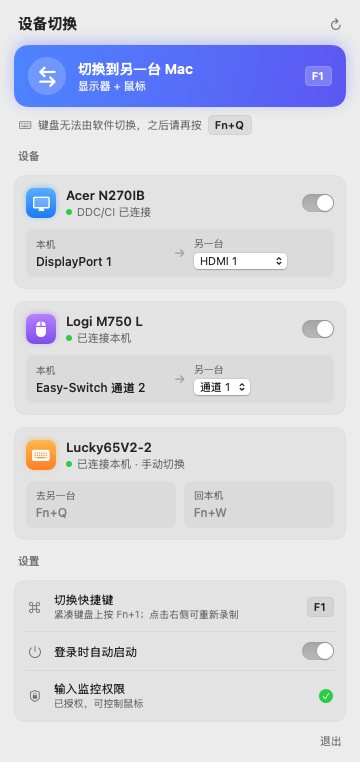

# MacKVM · Mac 外设一键切换

一个 macOS 菜单栏小工具（应用名 SwitchBar）：两台 Mac 共用一台显示器和一套键鼠时，**一键把显示器和鼠标切到另一台 Mac**，相当于一个软件 KVM。

不需要 KVM 硬件，也不需要两台 Mac 在同一个网络里——每台 Mac 各装一份，各自负责"把设备送到对面"。



## 功能

- **一键切换**：点菜单栏图标里的按钮，或按全局快捷键（默认 `F1`，紧凑键盘上是 `Fn+1`，可重新录制）。
- **显示器**：通过 DDC/CI 切换输入源，自动读取显示器支持的输入源和当前输入。
- **鼠标**：通过罗技 HID++ 协议切换 Easy-Switch 通道，自动读取通道数和当前通道。
- **键盘**：多数蓝牙键盘无法由软件切换，面板会提示切换后要按的组合键（默认通道 1/2/3 对应 `Fn+Q` / `Fn+W` / `Fn+E`，可改）。
- **配置自动识别**：首次打开时把"当前输入源/通道"记为本机，另一个记为对面，一般不用手动配置。
- **登录时自动启动**：面板里有开关。

## 适用条件

| 项目 | 要求 |
|---|---|
| 芯片 | Apple Silicon（M 系列）。Intel Mac 不支持 |
| 系统 | macOS 13 及以上 |
| 显示器 | 支持 DDC/CI，并且在显示器菜单里没有关闭它 |
| 鼠标 | 带 Easy-Switch 的罗技鼠标，蓝牙连接 |

实测过的组合只有一套：M4 Mac（macOS 15.6）+ Acer N270IB（DisplayPort）+ Logi M750 L（蓝牙）。其他情况按协议实现但未实机验证，特别是：

- 经 **HDMI 口**连接显示器时，部分 Mac 机型和扩展坞不转发 DDC 指令，此时显示器卡片会显示"DDC 无响应"。
- 鼠标经 **USB 接收器**（Bolt / Unifying）连接的路径未验证。

## 安装

在 [Releases](https://github.com/tshua/MacKVM/releases/latest) 页面有预编译的 ARM 版本。

### 方式一：用终端安装（推荐，不会被系统拦截）

```bash
curl -L -o /tmp/SwitchBar.zip https://github.com/tshua/MacKVM/releases/latest/download/SwitchBar-arm64.zip
ditto -x -k /tmp/SwitchBar.zip /Applications
open /Applications/SwitchBar.app
```

### 方式二：浏览器下载

下载 `SwitchBar-arm64.zip`，解压后把 `SwitchBar.app` 拖进"应用程序"。

这个应用**没有苹果开发者签名和公证**（只有本地临时签名），浏览器下载的文件会被系统打上隔离标记，直接双击会提示"无法验证…是否包含恶意软件"而打不开。任选一种方式放行：

- 终端执行一次，去掉隔离标记：

  ```bash
  xattr -dr com.apple.quarantine /Applications/SwitchBar.app
  ```

- 或者：先双击一次（会被拦下），然后到「系统设置 → 隐私与安全性」页面底部，点"仍要打开"。

## 首次使用

1. 打开后菜单栏出现 ⇄ 图标，没有 Dock 图标。
2. **授予输入监控权限**：给鼠标发指令需要这个权限。系统会弹出询问；或者在面板的"输入监控权限"一行点「去授权」，在打开的列表里打开 SwitchBar 的开关，应用会自动重启。没有这个权限时显示器仍可切换，鼠标不行。
3. 检查面板里"本机 → 另一台"的输入源和通道是否正确，不对就在下拉框里改。
4. 另一台 Mac 上同样安装一份。

### 日常操作

1. 按快捷键（或点按钮）：显示器和鼠标切到另一台。
2. 按键盘上的通道组合键（如 `Fn+Q`）：键盘切到另一台。

## 常见问题

**显示器切过去了，鼠标没动**
通常是输入监控权限失效。应用每次更新（重新下载或重新构建）后，系统都会把它当成新程序，需要重新授权：在面板里点「去授权」即可。

**切换后本机的显示器状态读不出来**
正常现象。显示器切到另一个输入后，本机到显示器的 DDC 通道就断了，切回来后恢复。

**快捷键 `F1` 和别的软件冲突**
在面板的"切换快捷键"一行点击键帽重新录制。需要带 `⌃` `⌥` `⌘` 之一，或使用 `F1`–`F12`。

**键盘为什么不能一起切**
大多数蓝牙键盘只暴露标准键盘接口，没有接收"切换通道"指令的私有通道，只能靠键盘自己的组合键。

## 从源码构建

只需要 Xcode 命令行工具（`xcode-select --install`），不需要 Xcode 工程：

```bash
./build.sh
```

产物在 `build/SwitchBar.app`。

## 目录结构

```
Sources/
  App.swift        菜单栏入口
  AppState.swift   状态、切换动作、热键、登录自启、授权流程
  Views.swift      面板界面（SwiftUI）
  DDC.swift        显示器 DDC/CI 读写
  Logi.swift       罗技 HID++ 通道切换
tools/             两个独立的命令行诊断工具（ddc.swift / logi.swift）
build.sh           构建脚本
```

### 命令行诊断工具

排查"某台 Mac 的视频口通不通 DDC"或"鼠标能不能收指令"时可以单独编译使用：

```bash
swiftc -O tools/ddc.swift -o ddc && ./ddc get 60
swiftc -O tools/logi.swift -o logi && ./logi info -v
```

## 原理

- **显示器**：经私有接口 `IOAVService` 向显示器发 DDC/CI 指令，写 VCP `0x60`（输入源）。
- **鼠标**：经 `IOHIDDevice` 向鼠标的 HID++ 私有接口发长报文，调用功能 `0x1814`（Change Host）。

两者都用到了未公开或厂商私有的接口，系统或固件更新后可能失效。
